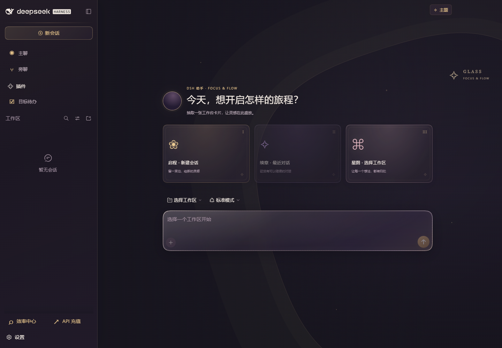
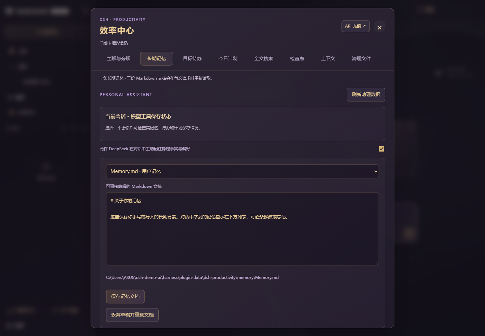
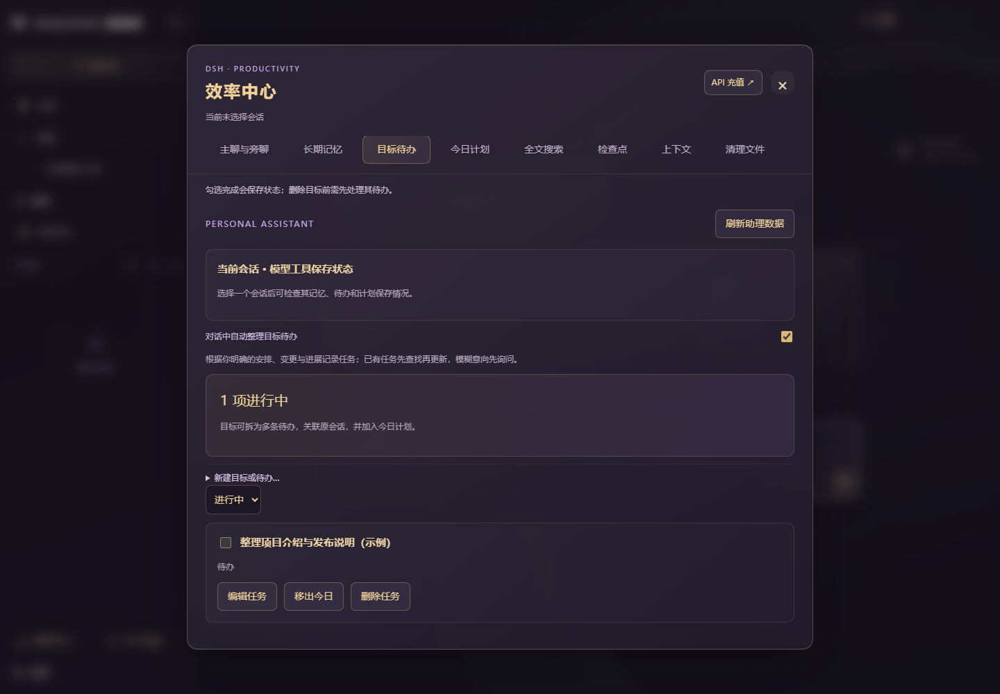
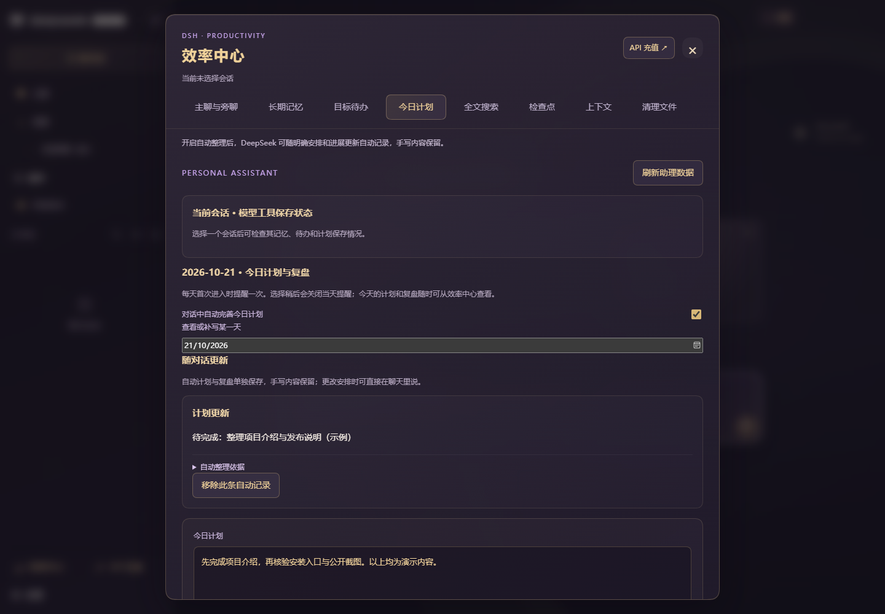
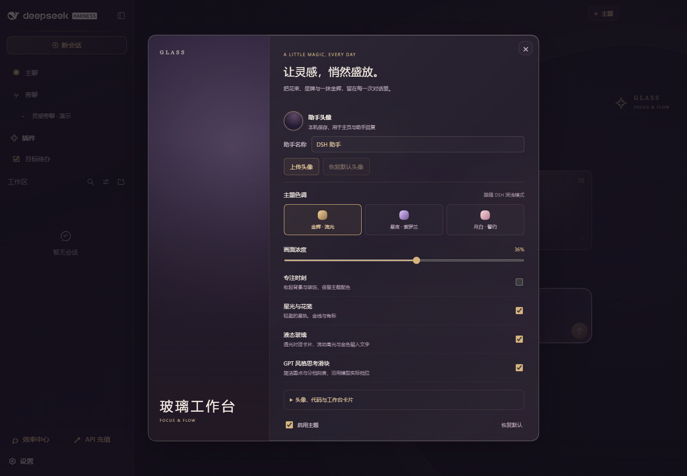

# DSH 原创主题与效率扩展

[English](README.en.md) · [下载](https://github.com/tszmzz1026/dsh-epindel-boot-animation/releases/latest) · [插件市场源](marketplace/README.md)

**纯代码界面美化 + 本地个人助理功能。当前版本不包含游戏图片、角色、模型、动画、语音或音乐。**

主题的背景、助手标记和装饰由 CSS 渐变与几何图形绘制；截图来自独立演示环境，仅包含示例数据。



## 选择下载

| 下载 | 包含内容 |
| --- | --- |
| [原创主题包](https://github.com/tszmzz1026/dsh-epindel-boot-animation/releases/download/suite-v2.0.0/dsh-beauty-v2.0.0.zip) | 金紫液态玻璃、金色输入、代码配色、卡片主页与阅读排版 |
| [效率扩展包](https://github.com/tszmzz1026/dsh-epindel-boot-animation/releases/download/suite-v2.0.0/dsh-extensions-v2.0.0.zip) | 主聊旁聊、长期记忆、目标待办、今日计划、搜索、检查点、上下文、清理指令与 MD 总结 |
| [完整无素材版](https://github.com/tszmzz1026/dsh-epindel-boot-animation/releases/download/suite-v2.0.0/dsh-full-v2.0.0.zip) | 原创主题 + 效率扩展 |

三个包均不含游戏素材。主题和扩展可以分别安装、叠加安装或分别卸载。推理滑块样式可美化已经安装的推理选择器；本包不分发其他作者的动画或推理插件。

## 安装与卸载

已验证环境：Windows、DSH Desktop 0.12.0、Harness 0.2.0-rc.2。先安装并启动一次 DSH；安装新主题前在插件页停用原有第三方主题，避免样式重叠。

1. 完整解压所选 ZIP，双击 `install-desktop.cmd`。
2. 等当前任务结束，从托盘完整退出 DSH 并重新打开。
3. 卸载时运行本包的 `uninstall-desktop.cmd`；完整包还提供按范围安装和卸载的入口。

终端方式（Node.js 22.19+ 的 22.x 或 24+）：

```powershell
node scripts/setup.mjs
node scripts/install-suite.mjs --check
node scripts/install-suite.mjs --bundle full
```

`--bundle beauty` 只装原创主题，`--bundle extensions` 只装效率中心。可组合 `--uninstall`；自定义位置使用 `--desktop-exe`、`--home`、`--profile` 或 `--dsh-command`。安装前备份 profile 清单和补丁，不复制模型配置、密钥或对话记录，不自动重启 DSH。

## 功能预览

| 长期记忆 | 目标待办 |
| --- | --- |
|  |  |



右上角「主题」支持自定义助手名称与本地头像上传，可拖动、缩放和裁切，并恢复默认头像。确认前可随时取消；上传的个人图片不会进入项目或公开发行包。



记忆和计划由当前模型通过真实工具保存，读取或口头回复不等于写入。面板分别显示保存成功、失败或被拒绝，可手动补整理。自动整理不会把每句话都变为记忆，模型功能使用安装者自己的 API。数据保存在 `DSH_HOME/plugin-data/dsh-productivity`，没有账号或跨设备同步。

## 开发与许可

```powershell
node scripts/test-suite.mjs
node scripts/package-bundles.mjs
```

代码采用 [MIT 许可](LICENSE)。当前发行只包含本项目界面代码、功能代码、安装脚本及无第三方游戏画面的演示截图；无任何游戏素材授权声明。项目独立于 DeepSeek 官方。问题反馈请附版本与复现步骤，不上传密钥和私人对话。
